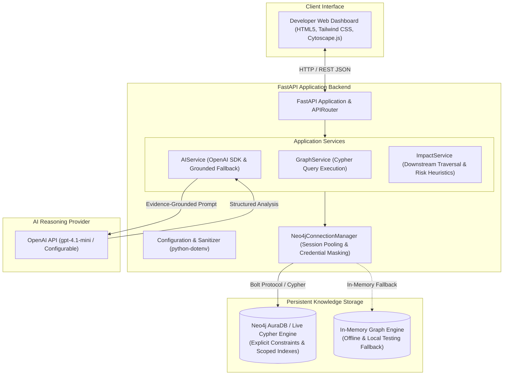
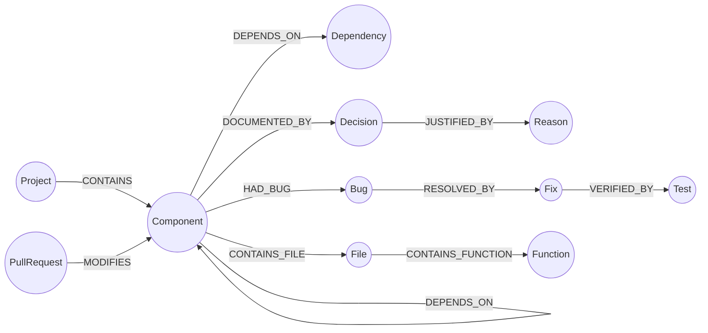

# CodeBrain AI

> **Every Bug Has a History**

[](https://www.python.org/)
[](https://fastapi.tiangolo.com)
[](https://neo4j.com/)
[](LICENSE)
[](tests/)

---

## 1. Introduction

Modern software development teams face an acute technical memory deficit. Critical architectural decisions, incident post-mortems, bug remediation patterns, and regression tests are fragmented across conversational chat channels, closed pull requests, issue trackers, and the transient memory of individual engineers. 

When complex regressions emerge—such as an unexpected `HTTP 401 Unauthorized` error following an authentication service refactor—engineers often spend hours re-diagnosing issues that were previously understood and resolved. Conventional chat-based AI coding assistants generate generic, ungrounded code snippets because they lack persistent, structured access to a repository's historical design rationale and component relationships.

**CodeBrain AI** is an AI-powered software engineering assistant that organizes project knowledge into a persistent **Neo4j graph database**. By connecting software components, technical decisions, historical bugs, remediations, and verification test suites into an explicit relational mesh, CodeBrain AI grounds developer inquiries in verified graph evidence, calculates downstream change impact, and prevents regression cycles before code is merged.

---

## 2. Problem Statement

Engineering teams routinely struggle with knowledge continuity and impact visibility:

1. **Repeated Investigation of Solved Issues:** Bugs with identical root causes recur across releases because past remediation steps and lessons learned are not systematically linked to the affected modules.
2. **Scattered Architectural Rationale:** Architectural Decision Records (ADRs) and trade-off justifications are buried in documentation silos, leading developers to inadvertently violate architectural constraints during refactoring.
3. **Onboarding Friction:** New engineers cannot easily query the historical context or dependency topology of the modules they maintain.
4. **Stateless AI Limitations:** Standard AI coding tools evaluate only the code provided in the immediate prompt window; they possess no persistent memory of prior failures or system invariants.
5. **Opaque Dependency Traversal:** Identifying transitive downstream consumers affected by a low-level module edit requires error-prone manual code reviews.

---

## 3. Proposed Solution & Workflow

CodeBrain AI addresses these challenges by unifying graph-based persistence, parameterized Cypher traversals, and evidence-grounded AI synthesis:

```
[ Developer Inquiry / Code Change ]
                │
                ▼
  [ 1. Parameterized Cypher Retrieval ]
  (Extracts decisions, past bugs, fixes, tests, and dependencies)
                │
                ▼
  [ 2. Context Construction & Factual Guardrails ]
  (Distinguishes verified facts from unverified hypotheses)
                │
                ▼
  [ 3. LLM Synthesis / Deterministic Fallback ]
  (Generates grounded investigation advice citing exact entity IDs)
                │
                ▼
  [ 4. Interactive Dashboard & Graph Highlighting ]
  (Renders synthesis, checklists, and highlights paths in Cytoscape.js)
```

### Knowledge Lifecycle:
1. **Record:** Architectural decisions (`Decision`) and incident remediations (`Bug`, `Fix`, `Test`) are captured into Neo4j via REST API or the dashboard interface.
2. **Connect:** Entities are linked to affected `Component` and `Dependency` nodes with directed relationships (`[:AFFECTS]`, `[:DEPENDS_ON]`, `[:RESOLVED_BY]`, `[:VERIFIED_BY]`).
3. **Retrieve:** When a developer submits a debugging question or lists modified files, Sentinel traverses the graph to extract historical evidence chains.
4. **Ground:** The AI assistant uses retrieved evidence records to construct an assessment, citing exact node identifiers (`DEC-101`, `BUG-101`) while explicitly labeling unconfirmed deductions as hypotheses.

---

## 4. Key Features

### Implemented Core Capabilities

* **Persistent Project Graph Memory:** Explicit Neo4j schema storing projects, components, external dependencies, technical decisions, bugs, fixes, and test suites with uniqueness constraints and indexed lookup.
* **Evidence-Grounded AI Debugging:** Evaluates developer inquiries against retrieved graph records. Clearly partitions output into **Documented Facts**, **Analogous Incidents**, and **Unverified Hypotheses**.
* **Deterministic Fallback Engine:** If external AI services are unconfigured or unavailable, an internal evidence-synthesis engine generates structured debugging guidance directly from graph traversal data without service disruption.
* **Dependency-Aware Change Impact Intelligence:** Traverses upstream and downstream `[:DEPENDS_ON]` paths (bounded 1–4 hops) to calculate the blast radius of component edits or changed source files (e.g., `services/auth/jwt.py`).
* **Heuristic Risk Prioritization:** Assigns `HIGH`, `MEDIUM`, or `LOW` review priorities based on the presence of historical regressions on the affected dependency path.
* **Interactive Cytoscape.js Knowledge Graph:** Web canvas supporting physics-based layouts, node filtering by category, zoom/fit controls, and an entity inspection drawer with neighborhood traversal.
* **Multi-Workspace Web Dashboard:** Responsive dark-themed developer dashboard organized into four distinct workspaces: Overview, Graph Explorer, AI Debugger, and Change Impact.
* **REST API & OpenAPI Documentation:** Fully typed FastAPI service with Pydantic v2 validation and auto-generated Swagger documentation at `/docs`.

### Planned Future Enhancements

* **Automated Source-Code AST Indexing:** Automated parsing of abstract syntax trees to extract function-level `[:CALLS]` relationships directly from Git repositories.
* **Native GitHub App & PR Webhooks:** Automatic ingestion of pull request descriptions and ADR markdown files upon pull request creation.
* **Semantic Vector Embeddings (GraphRAG):** Hybrid vector search combined with graph traversal to support open-domain semantic questions across unstructured incident post-mortems.
* **Enterprise Multi-Tenancy & Access Control:** Role-based access control (RBAC) and project isolation for multi-team organizations.
* **Autonomous Remediation Guidance:** Suggesting targeted Git patches based on historical fix patterns for verified bug categories.

---

## 5. System Architecture



### Component Responsibilities:
- **FastAPI Backend:** Serves REST endpoints, validates payloads with Pydantic models, handles CORS, and exposes health probes.
- **Neo4j Graph Database:** Functions as the sole persistent knowledge store. The LLM does *not* store state; all memory is retrieved from Neo4j at query time.
- **AIService:** Constructs strict anti-hallucination prompts from graph evidence. If the OpenAI API key is omitted, it executes transparent deterministic evidence reasoning.
- **Frontend Dashboard:** Provides four synchronized workspaces for system overview, graph exploration, contextual inquiry, and impact analysis.

---

## 6. Graph Data Model

The CodeBrain AI knowledge schema organizes projects into strongly typed nodes connected by directed relationships.



### Core Node Types:
| Node Label | Description | Key Properties |
|---|---|---|
| `Project` | Root project namespace | `id`, `name`, `description`, `version` |
| `Component` | Monitored architectural module | `id`, `name`, `description`, `tier` |
| `Dependency` | Internal or third-party library | `id`, `name`, `version`, `type` |
| `Decision` | Architectural Decision Record (ADR) | `id`, `title`, `description`, `author`, `timestamp` |
| `Reason` | Architectural justification | `id`, `summary`, `trade_offs` |
| `Bug` | Historical incident or defect | `id`, `title`, `symptom`, `root_cause`, `status` |
| `Fix` | Remediation description or commit | `id`, `description`, `commit_hash` |
| `Test` | Regression test suite | `id`, `name`, `test_type`, `verification_target` |
| `File` | Source code file | `id`, `path`, `language` |
| `Function` | Specific function or handler | `id`, `name`, `signature` |
| `PullRequest`| Merged pull request record | `id`, `number`, `title`, `url` |

### Cypher Schema & Seeding Example:

```cypher
// 1. Create unique constraints for entity identity
CREATE CONSTRAINT IF NOT EXISTS FOR (c:Component) REQUIRE c.id IS UNIQUE;
CREATE CONSTRAINT IF NOT EXISTS FOR (b:Bug) REQUIRE b.id IS UNIQUE;
CREATE CONSTRAINT IF NOT EXISTS FOR (f:Fix) REQUIRE f.id IS UNIQUE;

// 2. Idempotent creation of a component, incident, and fix
MERGE (c:Component {id: "COMP-AUTH"})
ON CREATE SET c.name = "Authentication", c.description = "Identity & token management";

MERGE (b:Bug {id: "BUG-101"})
ON CREATE SET b.title = "Users API 401 Unauthorized Error Post-Migration",
              b.symptom = "Users API rejected incoming requests with HTTP 401",
              b.root_cause = "Token extraction middleware looked for raw header rather than Bearer prefix",
              b.status = "RESOLVED";

MERGE (f:Fix {id: "FIX-101"})
ON CREATE SET f.description = "Updated AuthHeader parsing to strip Bearer prefix before JWT verification";

MERGE (c)-[:HAD_BUG]->(b)
MERGE (b)-[:RESOLVED_BY]->(f);
```

---

## 7. Technology Stack

| Layer | Technology | Version | Purpose in CodeBrain AI |
|---|---|---|---|
| **Backend Language** | Python | `>=3.11` | Application logic, graph orchestration, and API services |
| **API Framework** | FastAPI | `>=0.110.0` | Asynchronous REST routing, OpenAPI generation, static file serving |
| **ASGI Server** | Uvicorn | `>=0.29.0` | Production ASGI web server |
| **Graph Database** | Neo4j AuraDB / Neo4j Community | `>=5.18.0` | Relational knowledge storage and graph traversal engine |
| **Graph Driver** | neo4j (Official Python Driver) | `>=5.18.0` | Parameterized Bolt protocol query execution |
| **Query Language** | Cypher | Neo4j 5.x | Graph matching, path extraction, and schema constraint creation |
| **Validation** | Pydantic | `>=2.6.0` | Request payload schema validation and response serialization |
| **AI Integration** | OpenAI Python SDK | `>=1.14.0` | Grounded question synthesis (`gpt-4.1-mini` or user-configured model) |
| **Configuration** | python-dotenv | `>=1.0.0` | Secure environment variable management |
| **Testing** | Pytest, HTTPX | `>=8.0.0` | Automated unit, mock, and integration test execution |
| **Frontend UI** | HTML5, Tailwind CSS, Cytoscape.js | Vanilla JS | Single-page application, dark theme, interactive graph canvas |
| **Source Control** | Git & GitHub | — | Version control and collaborative code repository |

---

## 8. Example Workflow

### Scenario: Investigating an HTTP 401 Error Post-Refactor

1. **User Inquiry:** A developer opens the **AI Debugging Workspace** and submits:
   > *"The Users API returns HTTP 401 after the authentication refactor. Why might this happen, and what should I investigate before merging?"*
2. **Component Resolution:** CodeBrain AI maps the inquiry to `Authentication` (`COMP-AUTH`) and `Users API` (`COMP-USERS`).
3. **Graph Traversal:** The backend runs parameterized Cypher queries to extract connected historical nodes:
   - Decision `DEC-101`: Migration to JWT stateless tokens.
   - Incident `BUG-101`: Previous 401 regression caused by missing `Bearer` prefix handling in header extraction.
   - Resolution `FIX-101`: Updated `AuthHeader` parsing logic.
   - Regression Test `TEST-101`: Test validating authorization header format.
   - Dependency Path: `(Users API)-[:DEPENDS_ON]->(Authentication)`.
4. **Synthesis & Grounding:** The assistant constructs an assessment citing `BUG-101` as an **analogous historical incident**, outlines the verified fix, and lists unverified hypotheses for the current failure.
5. **Actionable Output:** The developer receives:
   - Grounded explanation citing exact records (`BUG-101`, `DEC-101`).
   - Actionable verification checklist (e.g., verify token signing secret and header prefix parsing).
   - Recommended pre-merge test suite (`TEST-101`).
   - One-click button to highlight the affected path on the Cytoscape graph.

> **Note on Retrieval Quality:** Sentinel's answers are strictly bounded by the relationships recorded in Neo4j. If a component has no recorded incidents or decisions, Sentinel reports the absence of evidence rather than generating ungrounded assumptions.

---

## 9. Team Structure and Responsibilities

For project organization, presentation, and functional responsibility allocation, the development of CodeBrain AI is structured across four key engineering disciplines:

| Role | Presentation Name | Core Functional Responsibilities |
|---|---|---|
| **Member 1** | Graph Database & Knowledge Modeling | • Neo4j schema design and unique constraint enforcement<br>• Cypher seed scripts (`seed.cypher`) and relationship definitions<br>• Parameterized multi-hop graph retrieval queries<br>• Project data scoping and isolation |
| **Member 2** | Backend & API Engineering | • FastAPI application lifecycle and modular routing<br>• Pydantic v2 request/response schema modeling<br>• Database connection management and connection pooling<br>• Error handling, logging, and credential masking |
| **Member 3** | AI Integration & Retrieval | • OpenAI SDK integration and prompt template design<br>• Anti-hallucination guardrails and facts vs. hypotheses separation<br>• Deterministic fallback engine for offline execution<br>• Context construction and evidence limitation handling |
| **Member 4** | Frontend & System Integration | • Single-page application UI design (Tailwind CSS)<br>• Cytoscape.js interactive knowledge graph visualization<br>• Dynamic workspace switching and entity inspector drawer<br>• End-to-end integration testing and production deployment setup |

*(Note: The above roles represent the presentation division of engineering responsibilities for documentation purposes).*

---

## 10. Project Structure

```text
Code-Brain-AI/
├── .env.example                  # Environment configuration template with placeholders
├── .gitignore                    # Git ignore file for secrets, caches, and environments
├── requirements.txt              # Pinned production Python dependencies
├── README.md                     # Comprehensive project documentation
├── backend/
│   └── app/
│       ├── __init__.py
│       ├── main.py               # FastAPI application entry point, lifespan, & static mount
│       ├── config.py             # Resilient configuration loader and input sanitization
│       ├── database.py           # Neo4jConnectionManager with connection retry & credential masking
│       ├── models.py             # Pydantic models for API requests, responses, and graph entities
│       ├── queries/
│       │   ├── schema.cypher     # Uniqueness constraints and performance indexes
│       │   ├── seed.cypher       # Idempotent MERGE script for baseline synthetic mesh
│       │   ├── retrieval.cypher  # Parameterized contextual evidence retrieval query
│       │   └── impact.cypher     # Bounded downstream dependency traversal query
│       ├── routes/
│       │   ├── health.py         # Diagnostic health endpoint (/api/health)
│       │   ├── seed.py           # Manual on-demand demo seeding endpoint (/api/seed)
│       │   ├── projects.py       # Registered projects listing (/api/projects)
│       │   ├── graph.py          # Knowledge graph retrieval endpoint (/api/graph)
│       │   ├── memory.py         # Architectural memory capture endpoint (/api/memory)
│       │   ├── analyze.py        # Evidence-grounded AI debugging endpoint (/api/analyze)
│       │   ├── impact.py         # Change impact analysis endpoint (/api/impact)
│       │   └── activity.py       # Chronological project audit trail (/api/activity)
│       └── services/
│           ├── graph_service.py  # Graph query execution and in-memory fallback engine
│           ├── ai_service.py     # OpenAI integration and deterministic evidence reasoning
│           └── impact_service.py # Blast radius propagation tiers and heuristic risk scoring
├── frontend/
│   ├── index.html                # Responsive 4-workspace dashboard with Tailwind CSS & Cytoscape.js
│   └── app.js                    # UI logic, Cytoscape renderer, graph filters, and API bindings
└── tests/
    ├── test_health.py            # Health probes and frontend static serving tests
    ├── test_validation.py        # Pydantic input constraint and validation tests
    ├── test_seed_and_graph.py    # Seed idempotency, count stability, and project isolation tests
    ├── test_memory.py            # Decision and bug persistence verification tests
    ├── test_ai_debugging_phase4.py # Evidence grounding, missing context, and fallback tests
    ├── test_change_impact_phase5.py # Direct edits, downstream consumers, and file resolution tests
    ├── test_demo_scenario.py     # End-to-end multi-step verification test
    ├── test_error_handling_and_mocks.py # Database failure, LLM failure, and security audit tests
    └── test_neo4j_integration.py # Live Neo4j AuraDB integration suite (conditionally executed)
```

---

## 11. Installation and Setup

### Prerequisites
- **Python:** Python 3.11 or 3.12 installed.
- **Git:** Installed on your path.
- **Neo4j Instance (Optional):** Neo4j AuraDB cloud instance or local Neo4j Desktop. *(If not provided, the application runs automatically using its built-in in-memory graph engine).*
- **OpenAI API Key (Optional):** *(If not provided, the application uses its built-in deterministic evidence reasoning engine).*

### Step-by-Step Setup (Windows PowerShell)

1. **Clone the Repository:**
   ```powershell
   git clone https://github.com/nagarjuna-32/neo4j.git Code-Brain-AI
   cd Code-Brain-AI
   ```

2. **Create and Activate a Virtual Environment:**
   ```powershell
   python -m venv .venv
   .\.venv\Scripts\Activate.ps1
   ```
   *(If script execution is restricted, run: `Set-ExecutionPolicy -Scope Process -ExecutionPolicy Bypass`)*

3. **Install Dependencies:**
   ```powershell
   pip install -r requirements.txt
   ```

4. **Configure Environment Variables:**
   Copy the example environment template:
   ```powershell
   Copy-Item .env.example .env
   ```
   Edit `.env` to configure your connection settings:
   ```env
   # Server Configuration
   HOST=0.0.0.0
   PORT=8000
   ENVIRONMENT=development
   AUTO_SEED=false

   # Neo4j Database Configuration (Optional - leave blank for in-memory mode)
   NEO4J_URI=neo4j+s://<your-db-id>.databases.neo4j.io
   NEO4J_USERNAME=neo4j
   NEO4J_PASSWORD=<your-auradb-password>
   NEO4J_DATABASE=neo4j

   # OpenAI API Configuration (Optional - leave blank for deterministic mode)
   OPENAI_API_KEY=sk-<your-api-key>
   OPENAI_MODEL=gpt-4.1-mini
   ```

5. **Start the Application:**
   ```powershell
   uvicorn backend.app.main:app --host 127.0.0.1 --port 8000
   ```

6. **Access the Application:**
   - **Interactive Web Dashboard:** Open [http://127.0.0.1:8000/](http://127.0.0.1:8000/) in your browser.
   - **Interactive OpenAPI Explorer (Swagger):** Open [http://127.0.0.1:8000/docs](http://127.0.0.1:8000/docs).
   - **Health Check Endpoint:** Open [http://127.0.0.1:8000/health](http://127.0.0.1:8000/health).

---

## 12. API Documentation

CodeBrain AI exposes a fully typed REST API. All endpoints accept and return JSON.

### Summary of Verified Endpoints

| Method | Endpoint | Description |
|---|---|---|
| `GET` | `/health` / `/healthz` | Root health probe for load balancers |
| `GET` | `/api/health` | Comprehensive system diagnostics and configuration status |
| `POST`| `/api/seed` | Manually seed the demo baseline project into the graph |
| `GET` | `/api/projects` | List all registered project identifiers |
| `GET` | `/api/graph` | Retrieve nodes, relationships, and stats for a given project |
| `POST`| `/api/memory` | Capture a new technical decision or bug incident into graph memory |
| `POST`| `/api/analyze` | Submit an engineering inquiry for evidence-grounded AI debugging |
| `POST`| `/api/impact` | Calculate downstream impact and review priority for code changes |
| `GET` | `/api/activity` | Retrieve the chronological audit stream of project memory events |

---

### Endpoint Details

#### 1. Contextual AI Debugging
* **`POST /api/analyze`**
* **Request Body:**
  ```json
  {
    "project_id": "PRJ-SENTINEL",
    "question": "The Users API returns HTTP 401 after the authentication refactor. Why might this happen?",
    "component": "Authentication"
  }
  ```
* **Response (`HTTP 200 OK`):**
  ```json
  {
    "project_id": "PRJ-SENTINEL",
    "detected_component": "Authentication",
    "source": "OpenAI (gpt-4.1-mini)" ,
    "assessment": "Authentication was recently refactored to stateless JWTs under DEC-101. A similar 401 regression occurred previously under BUG-101.",
    "relevant_evidence": [
      {
        "id": "BUG-101",
        "type": "Bug",
        "title": "Users API 401 Unauthorized Error Post-Migration",
        "details": {
          "root_cause": "Token extraction middleware looked for raw header rather than Bearer prefix",
          "resolution": "Updated AuthHeader parsing to strip Bearer prefix"
        }
      }
    ],
    "potential_root_causes": [
      "Authorization header missing 'Bearer ' prefix expected by the JWT middleware (Analogous to BUG-101)",
      "JWT token validation failure due to mismatched signing algorithm or expired claims"
    ],
    "suggested_checks": [
      "Verify incoming request headers contain 'Authorization: Bearer <token>'",
      "Confirm JWT secret matches the issuer configuration"
    ],
    "suggested_tests": [
      "TEST-101: Validate Users API Authorization Header Parsing"
    ],
    "evidence_limitations": "Live server logs are required to confirm if 401 stems from token signature rejection or header absence."
  }
  ```

#### 2. Change Impact Analysis
* **`POST /api/impact`**
* **Request Body:**
  ```json
  {
    "project_id": "PRJ-SENTINEL",
    "changed_files": ["services/auth/jwt.py"]
  }
  ```
* **Response (`HTTP 200 OK`):**
  ```json
  {
    "project_id": "PRJ-SENTINEL",
    "directly_changed": ["Authentication"],
    "heuristic_priority": "HIGH",
    "priority_reasons": [
      "Direct modification to core module: Authentication",
      "Historical regression BUG-101 documented on affected path"
    ],
    "affected_components": [
      {
        "id": "COMP-AUTH",
        "name": "Authentication",
        "tier": "direct",
        "reason": "Directly modified component",
        "path": ["Authentication"]
      },
      {
        "id": "COMP-USERS",
        "name": "Users API",
        "tier": "downstream_1",
        "reason": "Direct consumer of Authentication",
        "path": ["Authentication", "Users API"]
      },
      {
        "id": "COMP-ADMIN",
        "name": "Admin Dashboard",
        "tier": "downstream_2",
        "reason": "Transitive consumer through Users API",
        "path": ["Authentication", "Users API", "Admin Dashboard"]
      }
    ],
    "historical_risks": [
      {
        "bug_id": "BUG-101",
        "component": "Authentication",
        "title": "Users API 401 Unauthorized Error Post-Migration",
        "root_cause": "Token extraction middleware looked for raw header rather than Bearer prefix"
      }
    ],
    "suggested_tests": [
      {
        "test_id": "TEST-101",
        "target_component": "Authentication",
        "title": "Validate Users API Authorization Header Parsing"
      }
    ]
  }
  ```

#### 3. Capture Project Memory
* **`POST /api/memory`**
* **Request Body (Technical Decision):**
  ```json
  {
    "memory_type": "decision",
    "project_id": "PRJ-SENTINEL",
    "title": "DEC-102: Migrate Token Signature Algorithm to Ed25519",
    "affected_component": "Authentication",
    "reason": "Enhanced cryptographic performance and reduced CPU overhead during signature validation",
    "author": "Lead Security Engineer"
  }
  ```
* **Response (`HTTP 201 Created`):**
  ```json
  {
    "status": "success",
    "entity_id": "DEC-102",
    "entity_type": "Decision",
    "message": "Memory captured and persisted to graph successfully."
  }
  ```

---

## 13. Security and Reliability

CodeBrain AI applies standard defensive engineering practices across its backend and database layers:

1. **Environment-Based Secret Isolation:** All sensitive credentials (`NEO4J_PASSWORD`, `OPENAI_API_KEY`) are read strictly from environment variables or `.env`. No credentials are committed to version control.
2. **Credential Sanitization in Logs:** The `Neo4jConnectionManager` actively inspects database exception strings and masks password values with `******` before writing to application logs.
3. **Cypher Injection Mitigation:** User inputs are never directly concatenated into Cypher query strings. All database queries execute with parameterized arguments (`$project_id`, `$component_name`, `$title`).
4. **Pydantic Validation:** Request payloads are checked for length, non-empty content, and enumerated choices (`memory_type`, `heuristic_priority`).
5. **Anti-Hallucination Guardrails:** Retrieved evidence records are labeled with explicit verification statuses. The system never claims that an analogous bug proves a current defect without runtime verification.
6. **Graceful Degradation:** If external connectivity to Neo4j AuraDB or the OpenAI API is interrupted, the application switches to its deterministic evidence engine and in-memory repository to prevent service failure.

---

## 14. Testing

CodeBrain AI includes an automated test suite executed with `pytest`.

### Running Tests

```powershell
# Run the complete test suite
python -m pytest -v

# Run with output capture disabled for debugging
python -m pytest -v -s
```

### Test Suite Overview:
* **`tests/test_health.py`:** Verifies health diagnostic payloads, root deployment probes, and frontend static asset delivery.
* **`tests/test_validation.py`:** Validates Pydantic boundary conditions, missing fields, and type constraints.
* **`tests/test_seed_and_graph.py`:** Verifies idempotent seeding, count stability across repeated runs, and project scoping.
* **`tests/test_memory.py`:** Tests dynamic creation and persistence of architectural decisions and bug reports.
* **`tests/test_ai_debugging_phase4.py`:** Verifies that the LLM receives retrieved graph evidence, handles empty context, and falls back gracefully.
* **`tests/test_change_impact_phase5.py`:** Tests file path mapping, bounded downstream traversal, historical risk retrieval, and unknown component handling.
* **`tests/test_error_handling_and_mocks.py`:** Mocks database and AI service failures to ensure proper error masking and parameter injection resilience.
* **`tests/test_neo4j_integration.py`:** Live integration suite against a real Neo4j instance *(automatically skipped when live cloud credentials are not present in `.env`)*.

---

## 15. Production Deployment

CodeBrain AI is pre-configured for deployment on containerized PaaS providers such as **Render.com**, Railway, or self-hosted Linux servers.

### Deployment Configuration (Render.com)

1. **Create Web Service:** Connect your GitHub repository (`https://github.com/nagarjuna-32/neo4j`).
2. **Configure Service Settings:**
   - **Runtime:** `Python 3`
   - **Branch:** `main`
   - **Build Command:** `pip install -r requirements.txt`
   - **Start Command:** `uvicorn backend.app.main:app --host 0.0.0.0 --port $PORT`
   - **Health Check Path:** `/health` (or `/healthz`)
3. **Environment Variables:**
   ```env
   PORT=8000
   AUTO_SEED=false
   NEO4J_URI=neo4j+s://<your-db-id>.databases.neo4j.io
   NEO4J_USERNAME=neo4j
   NEO4J_PASSWORD=<your-db-password>
   NEO4J_DATABASE=neo4j
   OPENAI_API_KEY=sk-<your-openai-key>
   OPENAI_MODEL=gpt-4.1-mini
   ```
4. **Manual Seeding in Production:**
   Automatic startup seeding is disabled by default (`AUTO_SEED=false`) to preserve database state across container restarts. To seed the initial demo data, click **"Seed Demo Graph"** in the web dashboard or issue an HTTP request:
   ```bash
   curl -X POST https://<your-service-url>.onrender.com/api/seed
   ```

---

## 16. Development Roadmap

- [x] **Phase 1 — Core Architecture:** FastAPI application, configuration loader, static frontend mounting, and health checks.
- [x] **Phase 2 — Graph Knowledge Modeling:** Explicit Neo4j schema, uniqueness constraints, idempotent seeding, and parameterized Cypher traversal.
- [x] **Phase 3 — Backend API Engineering:** Typed Pydantic schemas, database exception shielding, parameter injection defense, and activity auditing.
- [x] **Phase 4 — Contextual AI Debugging:** Grounded LLM reasoning, evidence citation, facts vs. hypotheses partitioning, and deterministic fallback.
- [x] **Phase 5 — Change Impact Analysis:** Bounded multi-tier downstream dependency traversal, file path resolution, and heuristic risk scoring.
- [x] **Phase 6 — Multi-Workspace Dashboard:** Responsive UI with Overview, Cytoscape Graph Explorer, Contextual Debugger, and Change Impact visualizer.
- [x] **Phase 7 — Verification & Testing:** 37 automated tests covering unit, mock, security, and integration workflows.
- [x] **Phase 8 — Production Deployment Readiness:** Deployment health probes (`/health`, `/healthz`), dynamic `$PORT` binding, and production configuration.
- [ ] **Phase 9 — AST Source-Code Parsing (Planned):** Extracting call-graph hierarchies from Git commits into `[:CALLS]` relationships.
- [ ] **Phase 10 — Native GitHub App (Planned):** Ingesting Architecture Decision Records directly from pull request merges.

---

## 17. Contribution, License, and Contact

### Contributing
1. Fork the repository on GitHub.
2. Create a feature branch: `git checkout -b feature/your-feature-name`.
3. Commit your changes: `git commit -m "feat: description of change"`.
4. Push to the branch: `git push origin feature/your-feature-name`.
5. Open a Pull Request with a clear summary of modifications and test verification.

### License
This project is open-source and distributed under the **MIT License**. See the `LICENSE` file for details.

### Contact & Repository Information
- **Repository:** [https://github.com/nagarjuna-32/neo4j](https://github.com/nagarjuna-32/neo4j)
- **Maintainer:** [Project Maintainer / Team Lead]
- **Bug Reports & Inquiries:** Please open an issue on the GitHub issue tracker.
