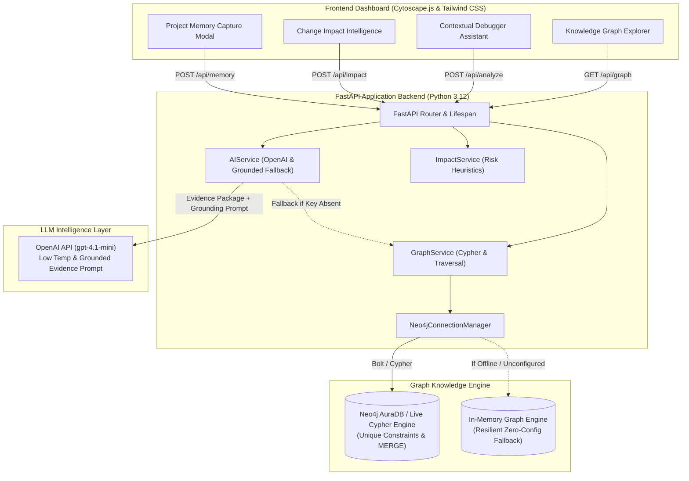

# DevGraph Sentinel — AI Engineering Memory & Change Impact Intelligence

> *"Understand the past. Predict the impact. Prevent the next bug."*  
> **Hackathon:** Neo4j Graph Builder — Build Sprint Bengaluru | *hackFront India 2026 Pre-Hack Series*

---

## 1. Problem Statement

Developers lose hundreds of engineering hours every sprint because technical decisions, component dependencies, previous bug post-mortems, and regression test suites are scattered across disconnected pull requests, Slack threads, Jira tickets, and developer memory.

When an incident strikes (such as an unexpected HTTP 401 Unauthorized error after an authentication refactor), conventional AI coding assistants offer generic, ungrounded debugging advice. They lack persistent, relational project memory and cannot explain *why* an architectural decision was made (e.g., migrating to stateless JWTs) or *how* a similar regression was previously resolved.

---

## 2. Proposed Solution

**DevGraph Sentinel** is an AI engineering intelligence platform powered by **Neo4j** that connects:
1. **Persistent Project Memory:** First-class capture of Architecture Decision Records (`Decision`, `Reason`), bug incidents (`Bug`), remediation commits (`Fix`), and regression suites (`Test`).
2. **Contextual Debugging Assistant:** Uses Cypher graph traversals to extract grounded historical evidence, citing exact node IDs (`DEC-101`, `BUG-101`, `FIX-101`, `TEST-101`) and distinguishing historical facts from current hypotheses.
3. **Dependency-Aware Change Impact Intelligence:** Traverses upstream/downstream `DEPENDS_ON` relationships to identify indirectly affected consumer services, elevate risk heuristics, and recommend pre-merge regression tests.
4. **Interactive Knowledge Graph:** Real-time visualization using **Cytoscape.js** with node inspection, layout controls, category filters, and edge relationship labels directly reflecting Neo4j database state.

---

## 3. System Architecture



---

## 4. Neo4j Graph Data Model

### Node Labels
- `Project`: Root workspace entity (`id: 'PRJ-SENTINEL'`).
- `Component`: System service or module (`Authentication`, `Users API`, `Admin Dashboard`, `Notification Service`).
- `Decision`: Architectural technical decision (`DEC-101: Migrate session authentication to JWT`).
- `Reason`: Justification for a technical decision (`RSN-101: Support authenticated mobile clients`).
- `Bug`: Documented defect or incident (`BUG-101: Users API returns HTTP 401 after authentication refactor`).
- `Fix`: Remediation applied (`FIX-101: Restore refresh-token middleware registration`).
- `Test`: Automated regression test (`TEST-101: test_refresh_token_validation_and_auth_flow`).
- `Dependency`: Upstream libraries and infrastructure (`JWT`, `FastAPI`, `PostgreSQL`).
- `PullRequest`: Source control pull request (`PR-101`, `PR-108`).
- `Developer`: Engineering contributors (`DEV-ALICE`, `DEV-BOB`).

### Relationships
- `(Project)-[:HAS_COMPONENT]->(Component)`
- `(Component)-[:DEPENDS_ON]->(Component)` *(Consumer -> Provider)*
- `(Component)-[:DEPENDS_ON]->(Dependency)`
- `(Component)-[:AFFECTED_BY]->(Decision)`
- `(Decision)-[:JUSTIFIED_BY]->(Reason)`
- `(Component)-[:HAS_BUG]->(Bug)`
- `(Bug)-[:RESOLVED_BY]->(Fix)`
- `(Fix)-[:VERIFIED_BY]->(Test)`
- `(Bug)-[:RELATED_TO]->(Decision)`
- `(Decision)-[:DECIDED_IN]->(PullRequest)`
- `(Bug)-[:CHANGED_IN]->(PullRequest)`
- `(Developer)-[:AUTHORED]->(PullRequest)`

---

## 5. Environment Configuration

Copy `.env.example` to `.env`:

```bash
cp .env.example .env
```

### Configuration Variables

| Variable | Description | Default | Required? |
|---|---|---|---|
| `HOST` | Server host address | `0.0.0.0` | No |
| `PORT` | Server listening port | `8000` | No |
| `NEO4J_URI` | Neo4j AuraDB or local Bolt URI | `neo4j+s://<dbid>.databases.neo4j.io` | Optional (falls back to In-Memory Engine) |
| `NEO4J_USERNAME` | Neo4j database username | `neo4j` | Optional |
| `NEO4J_PASSWORD` | Neo4j database password | - | Optional |
| `NEO4J_DATABASE` | Target Neo4j database name | `neo4j` | No |
| `OPENAI_API_KEY` | OpenAI API key for LLM synthesis | `sk-...` | Optional (uses deterministic engine if absent) |
| `OPENAI_MODEL` | Target OpenAI model | `gpt-4.1-mini` | No |
| `OPENAI_TEMPERATURE` | Model temperature (low for grounding) | `0.2` | No |

> **Resilient Fallback Mode:** DevGraph Sentinel operates seamlessly out of the box even without external Neo4j credentials or OpenAI API keys by providing a self-contained local graph engine and deterministic evidence synthesizer. When credentials are provided in `.env`, it automatically connects to live Neo4j AuraDB and runs live Cypher queries.

---

## 6. How to Run

### 1. Install Dependencies
```bash
pip install -r requirements.txt
```

### 2. Start the Application
```bash
python -m uvicorn backend.app.main:app --host 0.0.0.0 --port 8000 --reload
```

### 3. Access the Dashboard
- **Web UI & Graph Explorer:** Open [http://localhost:8000](http://localhost:8000)
- **Interactive OpenAPI Documentation:** Open [http://localhost:8000/docs](http://localhost:8000/docs)

---

## 7. Running Automated Tests

Run the complete 16-test automated suite:

```bash
python -m pytest tests/ -v
```

The test suite validates:
- Health diagnostics and status reporting (`test_health.py`)
- Pydantic schema validation and bounds checks (`test_validation.py`)
- Idempotent seed Cypher operations and graph structure (`test_seed_and_graph.py`)
- Decision and bug persistence into Neo4j graph (`test_memory.py`)
- Contextual debugging analysis and change impact propagation (`test_analyze_and_impact.py`)
- **Full 9-step Hackathon Demo Scenario (`test_demo_scenario.py`)**

---

## 8. API Specification

| Method | Endpoint | Description |
|---|---|---|
| `GET` | `/api/health` | Service health, Neo4j connection status, AI configuration, safe diagnostics |
| `POST` | `/api/seed` | Idempotent synthetic demo graph seed using Cypher `MERGE` |
| `GET` | `/api/projects` | List available projects with node/component metrics |
| `GET` | `/api/graph?project_id=...` | Retrieve nodes, edges, and statistics for Cytoscape.js |
| `POST` | `/api/memory` | Persist an architectural decision or bug into Neo4j project memory |
| `POST` | `/api/analyze` | Contextual debugging inquiry grounded in Neo4j evidence paths |
| `POST` | `/api/impact` | Graph-traversal change impact calculation with heuristic risk tiers |
| `GET` | `/api/activity?project_id=...` | Retrieve chronological timeline of project memory events |

---

## 9. Official Hackathon Demo Scenario Flow

Follow these 9 steps during the live hackathon demonstration:

1. **Step 1 — Seed Demo Graph:** Click **"Seed Demo Graph"** in the top navigation bar. Sentinel idempotently initializes `PRJ-SENTINEL`.
2. **Step 2 — Explore Knowledge Graph:** View the 4 core components (`Authentication`, `Users API`, `Admin Dashboard`, `Notification Service`), dependencies (`JWT`, `FastAPI`, `PostgreSQL`), `DEC-101`, `BUG-101`, `FIX-101`, and `TEST-101`. Click on any node to inspect its properties and neighbor connections in the side drawer.
3. **Step 3 — Submit Contextual Debugging Query:** Switch to the **Contextual Debugger** tab. Click the **"Demo Scenario"** prompt pill:
   > *"The Users API returns HTTP 401 after the authentication refactor. Why might this happen, and what should I investigate before merging?"*
4. **Step 4 — Review Retrieved Historical Evidence:** Observe the evidence cards highlighting historical incident `BUG-101` and architectural decision `DEC-101`.
5. **Step 5 — Explain Past Analogy:** The assistant clearly explains that past refactoring omitted refresh-token validation middleware (`FIX-101`), distinguishing this stored fact from current hypotheses.
6. **Step 6 — Actionable Pre-Merge Checklist:** Review concrete checks (middleware registration order, token expiry, refresh grace period) and recommended regression suite (`TEST-101`).
7. **Step 7 — Inspect Supporting Graph Paths:** View exact Cypher traversal chains, e.g.:  
   `(Authentication)-[:HAS_BUG]->(BUG-101)-[:RESOLVED_BY]->(FIX-101)-[:VERIFIED_BY]->(TEST-101)`
8. **Step 8 — Calculate Change Impact:** Switch to **Change Impact**, select `Authentication`, and click **"Calculate Downstream Impact"**. Observe that `Users API` (1-hop consumer) and `Admin Dashboard` (2-hop consumer) are flagged with **HIGH Risk** priority due to historical regression `BUG-101`. Click **"View in Graph"** to highlight the propagation chain.
9. **Step 9 — Capture New Project Memory:** Click **"+ Capture Memory"**, add a new technical decision (e.g., `DEC-102: Migrate Token Signing to Ed25519`), submit, and verify that the graph immediately updates and persists the new decision and relationships.

---

## 10. Team Roles & Responsibilities

| Team Member | Focus Area | Deliverables |
|---|---|---|
| **Member 1: Neo4j Graph Engineer** | Graph Data Architecture | Schema constraints (`schema.cypher`), idempotent seed scripts (`seed.cypher`), Cypher traversals, entity models |
| **Member 2: Backend & AI Engineer** | API & Grounded Reasoning | FastAPI endpoints, Pydantic schemas, OpenAI integration, anti-hallucination evidence prompts, deterministic fallback |
| **Member 3: Frontend & Demo Engineer** | UI/UX & Visualization | Cytoscape.js interactive graph, node inspector drawer, contextual debugger UI, impact report, responsive dark theme |

---

## 11. Hackathon Pitch

> *"Every engineering team has experienced the dreaded post-refactor regression: a critical service starts throwing 401 Unauthorized errors because an obscure middleware was omitted. The original developer who knew why the authentication system was designed that way has moved on, and conventional AI coding assistants simply guess.*
>
> *DevGraph Sentinel transforms engineering memory from scattered artifacts into an active, connected Neo4j knowledge graph. By linking architectural decisions, incident post-mortems, downstream consumers, and regression tests, Sentinel empowers developers to understand the past, predict change impact before merging, and prevent the next production outage."*

---

## 12. Limitations & Future Extensions

- **Current MVP Scope:** Evaluates component and dependency-level graph relationships for the synthetic project mesh.
- **Future Roadmap:**
  - Automated AST parsing to extract function-to-function `[:CALLS]` call graphs from Git commits.
  - Native GitHub App webhook integration to automatically ingest Pull Request descriptions and Architecture Decision Records (ADRs).
  - Graph-RAG vector embeddings on incident post-mortems for semantic sub-graph clustering.
